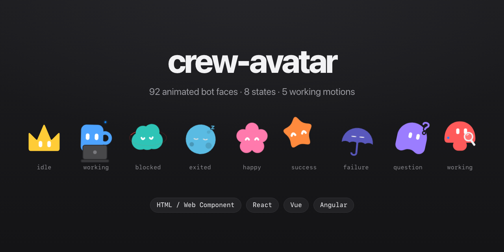

<p align="center">
  
</p>

# crew-avatar

Animated SVG bot faces with a mood. 52 shapes, 8 states and 5 working motions. The eyes follow your pointer. No runtime dependencies, and it honors `prefers-reduced-motion`.

They started out as the bot faces in Crew. One package covers plain HTML, React, Vue and Angular:

```sh
npm install crew-avatar
```

| Import | For |
| --- | --- |
| `crew-avatar` | Plain HTML: the `<crew-avatar>` custom element, plus the engine (`mountAvatar()`, shape data) |
| `crew-avatar/react` | React 18+ `<Avatar />` |
| `crew-avatar/vue` | Vue 3 `<Avatar />` |
| `crew-avatar/angular` | Angular 17+ standalone `<crew-avatar>` |

React, Vue and Angular are optional peer dependencies, so installing the package pulls in none of them.

## Usage

### HTML

```html
<script type="module" src="https://unpkg.com/crew-avatar/dist/crew-avatar.js"></script>

<crew-avatar shape="crown" color="#4da3ff" state="working" size="64"></crew-avatar>
```

Change any attribute and the face updates. For a classic script tag, `dist/crew-avatar.iife.js` exposes `window.CrewAvatar`.

### React

```tsx
import { Avatar } from "crew-avatar/react";

<Avatar shape="cup" state={busy ? "working" : "idle"} size={48} seed={user.id} label={user.name} />;
```

### Vue

```vue
<script setup>
import { Avatar } from "crew-avatar/vue";
</script>

<template>
  <Avatar shape="ghostish" :state="state" :size="48" :seed="user.id" />
</template>
```

### Angular

```ts
import { Avatar } from "crew-avatar/angular";

@Component({
  imports: [Avatar],
  template: `<crew-avatar shape="full-moon" [state]="state" [size]="48" [seed]="user.id" />`,
})
```

### Anything else

```js
import { mountAvatar } from "crew-avatar";

const avatar = mountAvatar(document.querySelector("#me"), { shape: "star", state: "idle" });
avatar.update({ shape: "star", state: "success" });
avatar.destroy();
```

The stylesheet is injected once on first mount. If you would rather link it yourself, it ships as `crew-avatar/crew-avatar.css`.

## Options

Every entry takes the same options, as props, inputs or attributes.

| Option | Type | Default | |
| --- | --- | --- | --- |
| `shape` | one of `SHAPE_NAMES` | from `seed` | `circle`, `crown`, `cup`, `full-moon`, … ([all 52](examples/vanilla/index.html)) |
| `color` | `#rgb` / `#rrggbb` | from `seed` | Only hex is accepted. Anything else falls back to the seeded color. |
| `state` | see below | `idle` | |
| `look` | `hustle` `magnifier` `laptop` `checklist` `keyboard` | random | The working motion. When it is left out, each run draws a new one and never repeats the last. |
| `size` | number (px) or CSS length | `40px` | Same as setting `--crew-avatar-size`. |
| `seed` | string | | A stable key such as a user id. It picks the default shape and color and offsets the animation so a row of faces doesn't move in lockstep. |
| `label` | string | | Accessible name. Without it the avatar is `aria-hidden`. |

## States

| State | What it does |
| --- | --- |
| `idle` | Glances around and blinks. Eyes follow the pointer while it's over the face. |
| `working` | Bobs, with a tilting orbit and one of five props (speed lines, magnifier, laptop, checklist, keyboard). |
| `blocked` | Shakes with worried brows inside a red ring. Use it for "waiting for approval". |
| `exited` | Asleep: eyes shut, slow breathing, Zs floating up. |
| `happy` | `^ ^` eyes. |
| `success` | Hops and dances. |
| `failure` | Droops with `- -` eyes and sulks. |
| `question` | Tilts its head, looks up, and a `?` pops out. |

To play `success` or `question` only once, set `--crew-avatar-mood-count: 1` on the avatar.

## Theming

The props and halos read a few CSS variables. Dark values are the default, light values apply under `prefers-color-scheme: light`, and `data-crew-avatar-theme="light" | "dark"` on any ancestor forces one or the other.

```css
:root {
  --crew-avatar-bg: #19191b;      /* page background, used for halos around ? and Z */
  --crew-avatar-ink: #f0f0f2;
  --crew-avatar-muted: #8e8e93;
  --crew-avatar-line: #2a2a2d;
  --crew-avatar-btn: #3a3a3c;
  --crew-avatar-btn-hover: #48484a;
  --crew-avatar-idle: #30d158;    /* checklist ticks */
  --crew-avatar-working: #0a84ff; /* orbit beads, pressed keys */
  --crew-avatar-blocked: #ff453a; /* blocked ring */
}
```

Below 28px the props hide themselves and only the face moves.

## Development

```sh
pnpm install
pnpm build       # dist/ for every entry
pnpm test        # core tests
pnpm examples    # bundle the React, Vue and Angular demos
pnpm serve       # http://localhost:5173/examples/vanilla/ (also /react/, /vue/, /angular/)
```

`examples/vanilla/index.html` is the full catalog: every shape in every state, with color, size and motion controls. It is plain HTML, CSS and JS with no build step.

## Credits

17 of the shapes (square, slanted, arch, fan, arrow, semi-circle, oval, clam-shell, gem, sunny, ghostish, clover, burst, flower, pixel-circle, pixel-triangle, bun) are [Material Shapes](https://github.com/androidx/androidx/blob/9a589fa61f8661e0cbef9123dcc98d3c1f655fc7/compose/material3/material3/src/commonMain/kotlin/androidx/compose/material3/MaterialShapes.kt) contours, © 2024 The Android Open Source Project, under the Apache License 2.0. They came by way of [Sidekick Studio](https://github.com/hanana-kick/sidekick). See [`third_party/material-shapes`](third_party/material-shapes).

## License

[MIT](LICENSE), except the Material Shapes contour data noted above (Apache 2.0).
